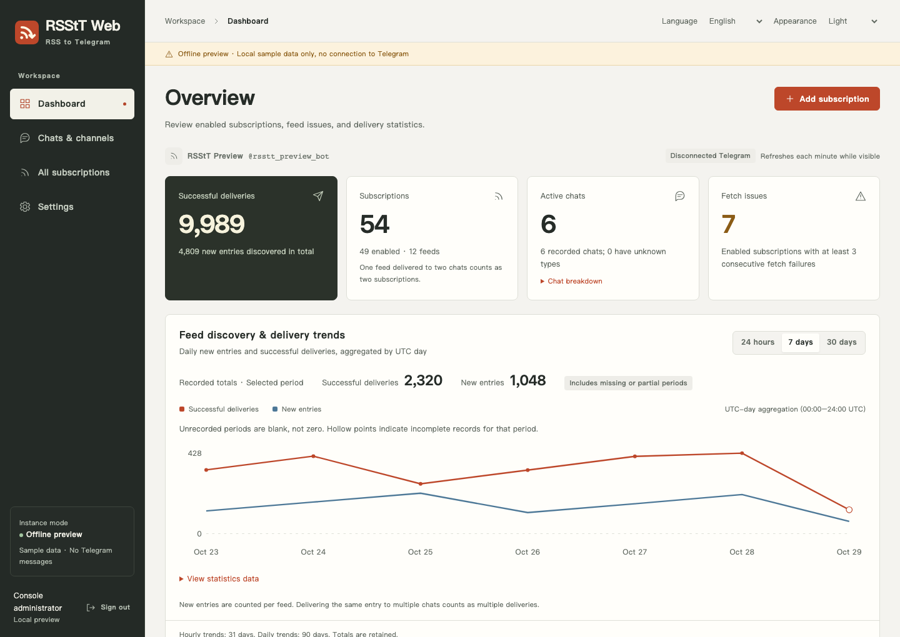

<p align="center">
  
</p>

<h1 align="center">RSStT Web</h1>

<p align="center">Your feeds. Your destinations. One console.</p>

<p align="center">
  English · <a href="README.zh.md">简体中文</a> · <a href="docs/web-console.md">Documentation</a> · <a href="LICENSE">AGPLv3+</a>
</p>



RSStT Web is a self-hosted Telegram RSS bot with a web console for subscriptions, destinations, access control, and operations. It builds on [RSS-to-Telegram-Bot](https://github.com/Rongronggg9/RSS-to-Telegram-Bot), preserving its Telegram commands, feed fetching, rich-text formatting, media handling, and shared delivery pipeline.

The console runs alongside the bot in one Python process. Its frontend uses static HTML, CSS, and JavaScript; production needs no Node.js service or frontend build step.

> This repository contains the Web fork. The upstream public bot, `rongronggg9/rss-to-telegram` images, and upstream PyPI installation instructions do not install this console. Build this checkout with the Compose file below. The console manages its own running instance, rather than attaching to a separate, unmodified bot.

## What you can manage

| Area               | Capabilities                                                                                                                                                                                                                                                                                                                   |
| ------------------ | ------------------------------------------------------------------------------------------------------------------------------------------------------------------------------------------------------------------------------------------------------------------------------------------------------------------------------ |
| Dashboard          | Known and active destinations, subscriptions and unique feeds, confirmed delivery totals, hourly and daily trends, and sources needing attention.                                                                                                                                                                              |
| Chats and channels | Search and filter destinations, set user roles and subscription limits, stop service, leave groups or channels, and inspect membership status. Banned destinations are hidden by default and can be viewed through filters. Departed destinations stay out of the chat list; the current interface has no filter to show them. |
| Subscriptions      | Search and filter by destination or state; pause, resume, and edit delivery options; add or replace recipients; import and export OPML. Multiple destinations share one feed fetch.                                                                                                                                            |
| Feed requests      | Set a User-Agent for an individual feed source without changing the global default.                                                                                                                                                                                                                                            |
| Notifications      | Configure repeated-fetch-failure, recovery, and new-destination alerts through Bark, Telegram, Webhook, or ntfy. Thresholds and cooldowns control repeated alerts; notifications start disabled.                                                                                                                               |
| Settings           | Manage Bot languages, formatting defaults, subscription limits, and supported runtime configuration. Settings that require a restart are marked explicitly.                                                                                                                                                                    |
| Agent access       | Issue revocable, destination-scoped read or write tokens; use the authenticated OpenAPI contract and a Python CLI with writes previewed by default.                                                                                                                                                                            |
| Backups            | Export, preflight, and stage SQLite backups for restore on restart. Choose whether to include or overwrite login credentials, Agent tokens, runtime configuration, and notification credentials.                                                                                                                               |
| Operation history  | View per-destination Bot, Web, and API actions, actors, outcomes, and observed setting changes. History is bounded and excludes ordinary chat text and raw credentials.                                                                                                                                                        |
| Interface          | English and Simplified Chinese, light and dark appearance, responsive layouts, and keyboard-accessible controls. Bot languages continue to use the upstream translations.                                                                                                                                                      |

Statistics begin when this version records them; old delivery history cannot be reconstructed. Operation history retains up to 100 entries per destination and 2,000 across the instance. See [chat service control and history](docs/chat-service-control.md) for status definitions and retention details.

**Runtime logs** help investigate feed fetching, Telegram delivery, notification transport, and console failures by feed or destination. Available details include the actual error, HTTP status, duration, and retry schedule. Logs retain up to 30 days and 5,000 entries, with at most 100 per feed; errors that older versions did not record cannot be reconstructed. See [runtime logs](docs/web-console.md#运行日志).

Subscription settings can check for updates immediately or explicitly send the latest article again to the current recipient as a test. For live acceptance while the original bot keeps running, use the [separate test bot deployment](docs/online-testing.md).

Recent articles retain up to 20 fetched articles and text summaries per feed, with delivery status tracked separately for each recipient. Unrecorded historical delivery cannot be reconstructed, and queued messages are not marked as delivered.

## Quick start with Docker Compose

You need Docker with the Compose plugin, a Telegram Bot Token from [BotFather](https://t.me/BotFather), and your numeric Telegram user ID for `MANAGER`.

```sh
git clone https://github.com/Jaaayden/rsstt-web.git
cd rsstt-web
```

Create a private `.env` next to `compose.console.yaml`, replacing the placeholders:

```dotenv
TOKEN=replace-with-your-botfather-token
MANAGER=123456789
WEB_PASSWORD=replace-with-a-private-random-password
WEB_ORIGIN=http://127.0.0.1:8730
```

`WEB_PASSWORD` must contain 16–512 characters. You can generate a random value with `openssl rand -hex 24`. `MANAGER` identifies a Telegram administrator; it is separate from the console login. Existing `API_ID` and `API_HASH` settings can also be supplied through `.env`.

```sh
chmod 600 .env
docker compose -f compose.console.yaml up -d --build
docker compose -f compose.console.yaml logs -f --tail=100 rsstt
```

Open **http://127.0.0.1:8730** and sign in with your initial console password. The login form requires only the password. The production console account is named `admin`.

The supplied Compose file builds `rsstt-web:local`, enables the console, and persists `./config` at `/app/config`. Inside the container the console listens on `0.0.0.0`; the published host port is bound only to `127.0.0.1`.

For a remote server, a local SSH tunnel preserves this setup:

```sh
ssh -L 8730:127.0.0.1:8730 user@server
```

For a host-based HTTPS reverse proxy, set `WEB_ORIGIN` to the exact address used by the browser, such as `https://rss.example.org`, and proxy to the loopback port. Keep the console at the origin root. Use the environment section in `compose.console.yaml` for additional deployment settings; supported application settings can also be saved in the console.

**Upgrading an existing bot:** back up its data and stop the old process before replacing it with this build. Keep the existing Token, Telegram session, and data directory. Run one bot process per session/database; starting another copy next to the existing bot is not an upgrade. The upstream `docker-compose.yml.sample` is retained as an upstream reference, not the Web deployment entry point.

## Run from source

Use Python 3.12 or 3.13 for the console. The Dockerfile uses Python 3.13.

```sh
python3.12 -m venv .venv
.venv/bin/python -m pip install -r requirements.txt
```

With the `.env` above and any required upstream network settings in place, start the original entry point with the console enabled:

```sh
WEB_ENABLED=1 WEB_HOST=127.0.0.1 WEB_PORT=8730 \
  .venv/bin/python telegramRSSbot.py -c ./config
```

`WEB_ENABLED` is off by default. See the [console guide](docs/web-console.md) for source deployment, authentication, reverse proxies, and snapshot previews, and the [upstream deployment guide](docs/deployment-guide.md) for Bot dependencies and Telegram configuration.

## Try the interface without a bot

The local demo uses sample data and offline RSS/Telegram substitutes. It binds to loopback, requires a private login password, and saves its independent databases in `.demo/`.

After creating the virtual environment:

```sh
export WEB_PASSWORD="$(.venv/bin/python -c 'import getpass; print(getpass.getpass("Initial console password: "))')"
.venv/bin/python -m src.management.demo
```

Open **http://127.0.0.1:8730**. Stop the demo with `Ctrl+C`. Use `WEB_PORT` and `WEB_DEMO_CONFIG` to choose a different port and an independent work directory. An existing demo keeps its stored password; entering a new environment value does not reset it.

For testing with an existing bot's SQLite data, the [offline snapshot workflow](docs/web-console.md#用线上真实数据做离线测试) creates an independent local working copy. It does not log in to Telegram or fetch RSS. Treat snapshots as private data and keep them out of Git, screenshots, and public artifacts.

## Data, login, and recovery

- Persist the whole `config` directory. It contains the original Bot data and Telegram session, the additive `console.sqlite3` management database, and saved `runtime-config.json` overrides when configured. The upstream Bot tables retain their existing schema and migration path.
- `WEB_PASSWORD` initializes an empty console account once. Later changes belong in **Settings → Account security**. Changing the environment variable does not replace the stored password. A restart or password change revokes browser sessions; Agent tokens remain subject to their own expiry and revocation.
- Runtime settings marked **Restart required** are saved for the next process start. Saving does not restart the bot or prove that external credentials and services work. Manager identity, database locations, listener configuration, and process options remain deployment settings.
- The Bot database can use SQLite or PostgreSQL. Web backup/export and automatic restore support **file-based SQLite**; automatic restore requires a POSIX host. PostgreSQL maintenance uses the separate documented database procedure.
- Backup exports exclude login credentials and Agent tokens unless explicitly selected. Restore preserves the destination's existing credentials by default. The main Bot Token, Telegram session, deployment environment, and browser sessions are never included in the logical backup.

Read [backup and restore](docs/pr-06-backups.md) before restoring data. A logical backup is not a substitute for protecting the deployment directory and Telegram session.

## Connect an Agent

In **Settings → API access tokens**, create a named token with read-only or subscription read/write permission, choose its destinations, and set its lifetime. The complete token is displayed once. It can be revoked immediately.

The API uses `Authorization: Bearer <token>`. The authenticated contract is available at `/api/openapi.json`; `/api/session` reports the token's scope. Subscription write access does not grant console administration, credential management, backup, or private interaction-history access.

The included CLI accepts a private token file, an environment variable, or standard input. For example, with a token stored in a file owned by you with mode `0600`:

```sh
.venv/bin/python -m src.management.agent_cli \
  --url http://127.0.0.1:8730 \
  --token-file /path/to/private/token-file \
  /api/session
```

Writes print a local plan unless `--apply` is supplied; deletion and recipient replacement also require `--confirm-delete`. See [authentication and Agent access](docs/pr-01-auth-agent.md) for the full contract and examples.

## Development and verification

Use Python 3.12/3.13 and Node.js 22 for browser tests. Node.js is only a development dependency.

```sh
.venv/bin/python -m pip install -r requirements-dev.txt
.venv/bin/python -m pytest -q
npm ci
npx playwright install --with-deps chromium
npm run test:e2e
```

Browser tests create their own demo database and password. The CI also checks Bot compatibility, legacy database migrations, installed-wheel resources and startup, Docker isolation, bounded-resource workloads, and Python/JavaScript CodeQL. See [CI coverage](docs/ci.md) for the matrix and its limits.

## Documentation

- [Web console and offline snapshots](docs/web-console.md)
- [Chat service control, membership status, and history](docs/chat-service-control.md)
- [User roles and runtime settings](docs/pr-02-users-settings.md)
- [Subscription filters, recipients, export, and per-feed UA](docs/pr-03-subscriptions.md)
- [Usage and hourly statistics](docs/pr-04-statistics.md)
- [Notifications](docs/pr-05-notifications.md)
- [Backup and restore](docs/pr-06-backups.md)
- [Upstream message formatting](docs/formatting-settings.md) · [Advanced Bot settings](docs/advanced-settings.md) · [Translation guide](docs/translation-guide.md)

## Upstream and license

RSStT Web builds on the work of **Rongrong and the RSS-to-Telegram-Bot contributors**. The upstream project originated as a fork of [BoKKeR/RSS-to-Telegram-Bot](https://github.com/BoKKeR/RSS-to-Telegram-Bot) in 2020 and subsequently developed a separate codebase. Upstream's [public bot](https://t.me/RSStT_Bot) and community are separate from this fork; they are not a hosted demo or support service for this console.

This project remains licensed under **[GNU AGPLv3 or later](LICENSE)**. Preserve the copyright and license notices, follow the license's source-availability requirements, and make a modified deployment's source link point to the corresponding code. The original notice is retained below.

```text
RSS to Telegram Bot
Copyright (C) 2020-2024  Rongrong <i@rong.moe>

This program is free software: you can redistribute it and/or modify
it under the terms of the GNU Affero General Public License as
published by the Free Software Foundation, either version 3 of the
License, or (at your option) any later version.

This program is distributed in the hope that it will be useful,
but WITHOUT ANY WARRANTY; without even the implied warranty of
MERCHANTABILITY or FITNESS FOR A PARTICULAR PURPOSE.  See the
GNU Affero General Public License for more details.

You should have received a copy of the GNU Affero General Public License
along with this program.  If not, see <https://www.gnu.org/licenses/>.
```
