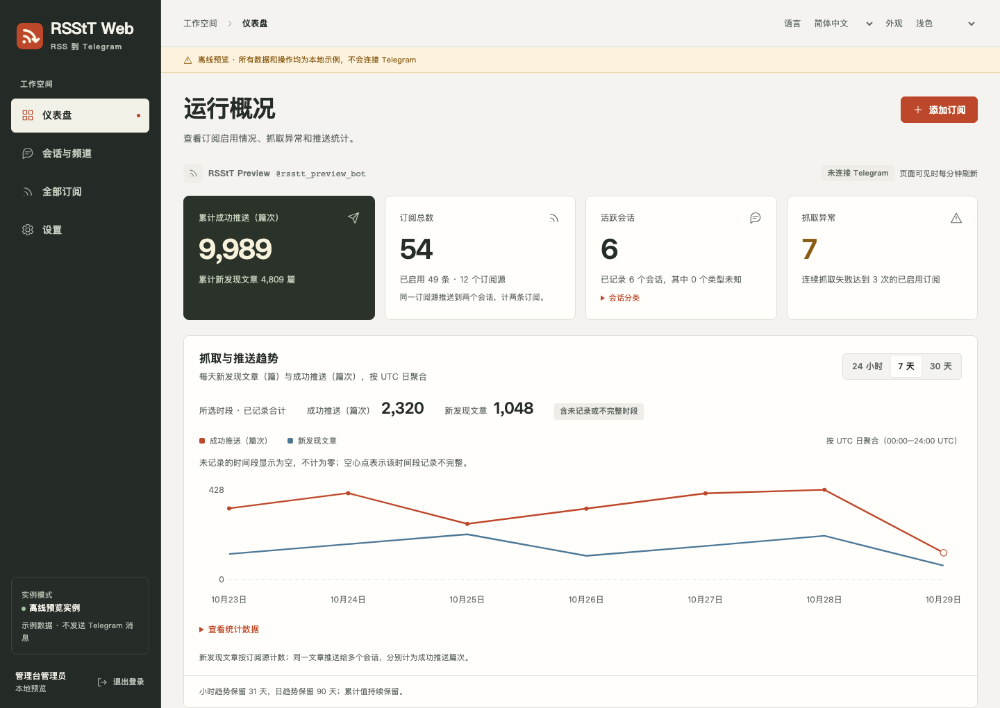

<p align="center">
  
</p>

<h1 align="center">RSStT Web</h1>

<p align="center">订阅、会话与推送，一处管理。</p>

<p align="center">
  <a href="README.md">English</a> · 简体中文 · <a href="docs/web-console.md">使用文档</a> · <a href="LICENSE">AGPLv3+</a>
</p>



RSStT Web 是带有网页管理台的自托管 Telegram RSS 机器人，可以集中管理订阅、接收会话、访问权限和运行配置。项目基于 [RSS-to-Telegram-Bot](https://github.com/Rongronggg9/RSS-to-Telegram-Bot)，保留上游的 Telegram 命令、RSS 抓取、富文本排版、媒体处理与共享推送流程。

管理台与机器人运行在同一个 Python 进程中。前端采用静态 HTML、CSS 和 JavaScript，生产运行无需 Node.js 服务或前端构建步骤。

> 本仓库提供 Web 二开版本。上游公共机器人、`rongronggg9/rss-to-telegram` 镜像和上游 PyPI 安装方式均不提供这里的管理台。请使用下方 Compose 配置从本仓库构建。管理台管理的是当前运行的增强版实例，不能直接接管另一个未修改的原版进程。

## 可以管理什么

| 区域       | 功能                                                                                                                                                                       |
| ---------- | -------------------------------------------------------------------------------------------------------------------------------------------------------------------------- |
| 仪表盘     | 已知及活跃会话、订阅关系与独立来源、已确认推送累计值、小时与每日趋势、需要检查的来源。                                                                                     |
| 会话与频道 | 搜索和筛选接收会话，设置用户角色及订阅上限，停止服务、退出群组或频道，查看成员状态。默认隐藏已封禁会话，可通过筛选查看；已退出会话不出现在会话列表中，当前无对应筛选入口。 |
| 全部订阅   | 按会话、状态等筛选，暂停、恢复、修改推送选项，追加或替换接收会话，导入导出 OPML。同一来源供多个会话使用时共享抓取。                                                        |
| 来源请求   | 为单个 RSS 来源设置 User-Agent，保留全局默认配置。                                                                                                                         |
| 通知       | 通过 Bark、Telegram、Webhook 或 ntfy 接收连续抓取失败、恢复和新会话接入通知；可设置阈值及冷却时间，默认关闭。                                                              |
| 设置       | 管理 Bot 语言、推送默认值、订阅上限和支持的运行配置；需要重启的设置明确标注。                                                                                              |
| Agent 接入 | 签发可撤销、按会话限定范围的只读或读写令牌；提供需认证的 OpenAPI 契约与默认预览写操作的 Python CLI。                                                                       |
| 备份与恢复 | 导出、预检和暂存 SQLite 备份，重启时恢复；可选择是否包含或覆盖登录凭据、Agent 令牌、运行配置和通知凭据。                                                                   |
| 操作记录   | 按会话查看 Bot、网页和 API 操作、发起人、结果以及观察到的设置变更；记录有数量上限，不保存普通聊天正文或原始凭据。                                                          |
| 界面       | 英文与简体中文、浅色与深色外观、适配窄屏及键盘操作。Bot 语言继续使用上游翻译。                                                                                             |

统计从启用本版本并开始记录时采集，无法补回旧版未保存的推送历史。操作记录每个会话最多保留 100 条，全实例最多 2000 条。状态定义和留存边界见[会话服务控制与操作记录](docs/chat-service-control.md)。

## 使用 Docker Compose 快速部署

需要 Docker 及 Compose 插件、从 [BotFather](https://t.me/BotFather) 获取的 Telegram Bot Token，以及用作 `MANAGER` 的个人 Telegram 数字 ID。

```sh
git clone https://github.com/Jaaayden/rsstt-web.git
cd rsstt-web
```

在 `compose.console.yaml` 同级目录创建私有的 `.env`，替换其中的占位值：

```dotenv
TOKEN=replace-with-your-botfather-token
MANAGER=123456789
WEB_PASSWORD=replace-with-a-private-random-password
WEB_ORIGIN=http://127.0.0.1:8730
```

`WEB_PASSWORD` 必须为 16–512 个字符，可以用 `openssl rand -hex 24` 生成随机值。`MANAGER` 是 Telegram 管理者身份，与网页登录账号独立。已有的 `API_ID`、`API_HASH` 也可放在 `.env` 中。

```sh
chmod 600 .env
docker compose -f compose.console.yaml up -d --build
docker compose -f compose.console.yaml logs -f --tail=100 rsstt
```

打开 **http://127.0.0.1:8730**，使用刚设置的初始密码登录。登录表单只需填写密码，生产管理台账号名称为 `admin`。

这份 Compose 配置构建本地镜像 `rsstt-web:local`，开启管理台，并将 `./config` 持久化到容器内的 `/app/config`。管理台在容器内监听 `0.0.0.0`，宿主机端口仅绑定 `127.0.0.1`。

如果部署在远程服务器，可以使用 SSH 隧道访问：

```sh
ssh -L 8730:127.0.0.1:8730 user@server
```

使用宿主机上的 HTTPS 反向代理时，将 `WEB_ORIGIN` 设置为浏览器实际访问的源站地址，例如 `https://rss.example.org`，并转发到回环端口。管理台应位于该源站的根路径。其他部署设置放在 `compose.console.yaml` 的环境变量部分；受支持的应用设置也可通过网页保存。

**升级已有机器人：**先备份数据、停止旧进程，再用本仓库构建替换。保留已有 Token、Telegram session 和数据目录。同一个 session／数据库只运行一个机器人进程；在旧机器人旁启动相同实例不是升级。仓库中的 `docker-compose.yml.sample` 保留作上游参考，Web 部署请使用 `compose.console.yaml`。

## 从源码运行

管理台建议使用 Python 3.12 或 3.13，Dockerfile 使用 Python 3.13。

```sh
python3.12 -m venv .venv
.venv/bin/python -m pip install -r requirements.txt
```

准备好上面的 `.env` 和实际需要的上游网络设置后，通过原有入口启动并开启管理台：

```sh
WEB_ENABLED=1 WEB_HOST=127.0.0.1 WEB_PORT=8730 \
  .venv/bin/python telegramRSSbot.py -c ./config
```

`WEB_ENABLED` 默认关闭。源码运行、认证、反向代理与快照预览详见[管理台文档](docs/web-console.md)；Bot 依赖和 Telegram 配置可参考[上游部署指南](docs/deployment-guide.md)。

## 不接机器人，先体验界面

本地演示使用示例数据和离线 RSS／Telegram 替身，监听回环地址并要求私有密码。独立数据库保存在 `.demo/` 中。

创建虚拟环境并安装依赖后运行：

```sh
export WEB_PASSWORD="$(.venv/bin/python -c 'import getpass; print(getpass.getpass("Initial console password: "))')"
.venv/bin/python -m src.management.demo
```

打开 **http://127.0.0.1:8730**，按 `Ctrl+C` 停止演示。可用 `WEB_PORT` 和 `WEB_DEMO_CONFIG` 指定其他端口及独立工作目录。已有演示库会保留存储的密码，修改环境变量不会重置它。

如果需要使用已有机器人的 SQLite 数据测试，[离线快照流程](docs/web-console.md#用线上真实数据做离线测试)可以创建独立的本地工作副本，不登录 Telegram、不抓取 RSS。快照属于私有数据，应与 Git、截图和公开产物隔离。

## 数据、登录与恢复

- 持久化整个 `config` 目录。这里包含原有 Bot 数据与 Telegram session、新增的 `console.sqlite3` 管理库，以及配置后生成的 `runtime-config.json` 网页覆盖值。上游 Bot 数据表继续沿用原有结构和迁移流程。
- `WEB_PASSWORD` 仅用于首次初始化空的管理台账号。之后请在 **设置 → 账户安全** 修改密码，修改环境变量不会覆盖已有密码。重启或改密会撤销网页登录会话；Agent 令牌按各自的有效期和撤销状态控制。
- 标记为“待重启”的运行配置在下次进程启动时应用。保存不会重启机器人，也不表示外部凭据或服务已经验证可用。管理者身份、数据库地址、监听配置和进程选项仍由部署配置管理。
- Bot 主库可使用 SQLite 或 PostgreSQL。网页备份导出及自动恢复支持**文件 SQLite**，自动恢复需要 POSIX 主机。PostgreSQL 使用文档中的独立数据库维护流程。
- 备份默认不包含网页登录凭据或 Agent 令牌，需显式勾选才导出；恢复时默认保留目标实例现有凭据。主机器人 Token、Telegram session、部署环境和网页登录会话始终不进入逻辑备份。

恢复数据前请阅读[备份与恢复说明](docs/pr-06-backups.md)。逻辑备份不能替代对部署目录和 Telegram session 的保护。

## 接入 Agent

在 **设置 → API 访问令牌** 创建有名称的令牌，选择只读或订阅读写权限、允许管理的会话和有效期。完整密钥只显示一次，可以随时撤销。

API 使用 `Authorization: Bearer <token>`。需认证的机器契约位于 `/api/openapi.json`，`/api/session` 可查询令牌范围。订阅读写权限不授予管理台管理、凭据管理、备份或私有交互记录读取权限。

内置 CLI 支持私有令牌文件、环境变量和标准输入。例如，将令牌保存在当前用户拥有且权限为 `0600` 的文件后：

```sh
.venv/bin/python -m src.management.agent_cli \
  --url http://127.0.0.1:8730 \
  --token-file /path/to/private/token-file \
  /api/session
```

写操作默认只打印本地计划，添加 `--apply` 才会执行；删除与接收者替换还需 `--confirm-delete`。完整契约和示例见[认证与 Agent 接入](docs/pr-01-auth-agent.md)。

## 开发与验证

后端和管理台使用 Python 3.12／3.13 验证，浏览器测试使用 Node.js 22。Node.js 仅为开发依赖。

```sh
.venv/bin/python -m pip install -r requirements-dev.txt
.venv/bin/python -m pytest -q
npm ci
npx playwright install --with-deps chromium
npm run test:e2e
```

浏览器测试会创建独立的演示数据库和密码。CI 还覆盖 Bot 兼容、旧数据库迁移、wheel 资源与安装后启动、Docker 隔离、资源限额负载，以及 Python／JavaScript CodeQL。测试矩阵和边界见 [CI 说明](docs/ci.md)。

## 文档入口

- [管理台与离线快照](docs/web-console.md)
- [会话服务控制、成员状态与操作记录](docs/chat-service-control.md)
- [用户角色与运行设置](docs/pr-02-users-settings.md)
- [订阅筛选、接收会话、导出与独立 UA](docs/pr-03-subscriptions.md)
- [使用量与小时统计](docs/pr-04-statistics.md)
- [通知](docs/pr-05-notifications.md)
- [备份与恢复](docs/pr-06-backups.md)
- [上游推送格式](docs/formatting-settings.md) · [Bot 高级设置](docs/advanced-settings.md) · [翻译指南](docs/translation-guide.md)

## 上游与许可

RSStT Web 基于 **Rongrong 和 RSS-to-Telegram-Bot 贡献者**的工作。上游项目于 2020 年从 [BoKKeR/RSS-to-Telegram-Bot](https://github.com/BoKKeR/RSS-to-Telegram-Bot) 分叉，之后逐步形成独立代码库。上游的[公共机器人](https://t.me/RSStT_Bot)及社区与本 fork 分别维护，不是这个管理台的在线演示或支持服务。

本项目继续采用 **[GNU AGPLv3 或更新版本](LICENSE)**。请保留版权和许可声明，遵守许可证中的源码提供要求，并让修改后部署所展示的源码链接指向对应代码。以下保留上游原始声明。

```text
RSS to Telegram Bot
Copyright (C) 2020-2024  Rongrong <i@rong.moe>

This program is free software: you can redistribute it and/or modify
it under the terms of the GNU Affero General Public License as
published by the Free Software Foundation, either version 3 of the
License, or (at your option) any later version.

This program is distributed in the hope that it will be useful,
but WITHOUT ANY WARRANTY; without even the implied warranty of
MERCHANTABILITY or FITNESS FOR A PARTICULAR PURPOSE.  See the
GNU Affero General Public License for more details.

You should have received a copy of the GNU Affero General Public License
along with this program.  If not, see <https://www.gnu.org/licenses/>.
```
